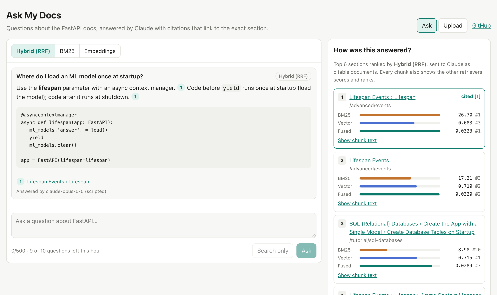
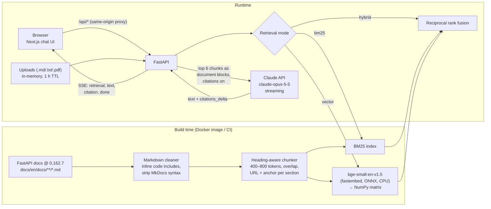

# Ask My Docs

[](https://github.com/Nilish1994/ask-my-docs/actions/workflows/ci.yml)
[](LICENSE)

**Documentation Q&A that shows its work.** Ask a question about the FastAPI docs. Claude streams back an answer in which every claim carries a citation chip linking to the exact docs section. A side panel shows which sections were retrieved and why, with BM25, embedding and fused scores. The retrieval layer is measured, not assumed: a 42-question eval compares BM25, embeddings and hybrid search, and runs in CI.

**Live demo:** [askdocs.imisstech.com.au](https://askdocs.imisstech.com.au) (10 questions per hour per visitor)



<sub>Local run. The retrieval, scores and citation-to-section mapping are real. The answer text in this screenshot is a scripted stream (labelled "scripted"), because no API key was used to build the repo.</sub>

## The problem

"Chat with your docs" demos are easy to build and hard to trust:

- **You can't check the answer.** Without a citation pointing at a specific passage, a fluent answer and a hallucinated one look the same.
- **Retrieval is a black box.** When an answer is wrong, it is usually because the right passage was never retrieved. Most demos never show what was retrieved, so you can't tell.
- **Choices go unmeasured.** BM25, embeddings or hybrid? Chunk size? Stemming? Without an eval, these are guesses.

This project tackles all three:

1. Answers use the Claude API's native citations, so every cited span maps back to a chunk and its docs URL with anchor.
2. Every answer exposes its retrieved context with per-retriever scores.
3. A small, hand-labelled eval reports hit@1, hit@5 and MRR for each retrieval mode, and CI fails if quality regresses.

## Retrieval quality

42 hand-written FastAPI questions, each labelled with the docs page(s) that answer it ([`eval/questions.jsonl`](eval/questions.jsonl)). The questions come in two styles:

- **keyword** (19 questions): uses the docs' own vocabulary, e.g. "How do I raise an HTTPException to return a 404 error?"
- **paraphrase** (23 questions): describes the need without it, e.g. "After a user signs up I want to send a welcome email without making them wait for it."

A hit means a chunk from a correct page appears in the top *k*. The corpus is 527 chunks from 142 pages of FastAPI 0.162.7.

| Mode | hit@1 | hit@5 | MRR@10 | hit@5 keyword | hit@5 paraphrase |
|---|---:|---:|---:|---:|---:|
| BM25 | 0.60 | 0.86 | 0.697 | 0.95 | 0.78 |
| Embeddings (bge-small) | 0.67 | 0.90 | 0.759 | 1.00 | 0.83 |
| **Hybrid (RRF)** | **0.74** | **0.93** | **0.828** | **1.00** | **0.87** |

Reproduce with `uv run python -m eval.run_retrieval_eval`. No LLM calls are made, and it runs in CI on every push. A search takes about 12 ms on a laptop CPU, covering the BM25 score, the query embedding and the fusion.

**What the numbers say**

- **Hybrid wins on every metric.** Fusion lifts hit@1 from 0.67 to 0.74 over embeddings alone. That matters because the top chunk is what Claude leans on most.
- **BM25 is weak on paraphrases** (0.78 hit@5) but strong when the question uses the docs' terms. Embeddings cover the paraphrases. RRF gets the best of both without tuning any weights.
- **Stemming hurt BM25** on this corpus, so it is off by default. With Porter stemming, BM25 hit@5 dropped from 0.86 to 0.76: the docs are code-heavy, and stemming merges identifiers that should stay distinct. The eval made this decision; `--stemming` reproduces the comparison.
- **Hybrid misses** (not in the top 5), kept rather than tuned away:
  - **q09**, "avoid sending the password hash back": this retrieves the OAuth2/JWT pages, which do discuss password hashing, instead of the Response Model page that answers the question.
  - **q22**, read-only vs delete permissions: the OAuth2 scopes page ranks 10th.
  - **q25**, timing every request: retrieval drifts to lifespan events rather than middleware.

## Architecture



## How it works

- **Ingest** ([`ingest/`](ingest)): downloads the FastAPI docs tarball at a pinned tag and keeps only `docs/en/docs/**/*.md` and `docs_src/`. It inlines the `{* docs_src/... *}` code examples, so code is searchable. It drops MkDocs-only syntax: admonitions, terminal-demo HTML and `:::` API directives. Project-admin pages (release notes, people, translations) are excluded.
- **Chunking** ([`ingest/chunker.py`](ingest/chunker.py)): splits at h1–h4 headings and merges small neighbouring sections up to about 400 tokens (never more than 800). Long sections are windowed at paragraph boundaries with an 80-token overlap, and code fences stay whole. Each chunk records the character offset of every section inside it, plus the URL and anchor of each, using the explicit `{ #id }` heading ids that fastapi.tiangolo.com uses.
- **Retrieval** ([`retrieval/`](retrieval)): runs BM25 (ported from my [retrieval-lab](https://github.com/Nilish1994/retrieval-lab)), cosine similarity over normalised bge-small vectors, and RRF (k = 60). Every search computes all three, so the UI can show each chunk's score under every method, whichever mode ranked it.
- **Answering** ([`answer/claude.py`](answer/claude.py)): sends the top 6 chunks to Claude as `document` blocks with `citations: {enabled: true}` and streams the response. Each `citations_delta` points at a character range in one document. The backend maps that range to the innermost heading containing it, so a chip links to `.../tutorial/cors/#use-corsmiddleware`, not just the page.
- **Uploads**: `POST /collections` builds a temporary per-user index from up to 5 Markdown, text or PDF files. Parsing happens in memory and nothing is written to disk. The collection expires after an hour.

## Design decisions

| Decision | Why |
|---|---|
| **API-native citations instead of "cite like [1]" prompting** | Citations come back as structured character ranges in the source document, not as text the model formats. They can't point at a chunk that wasn't provided, and they map back to section anchors deterministically. |
| **Hybrid retrieval with RRF, not a weighted score sum** | BM25 scores are unbounded and query-dependent, while cosine scores sit around 0.3–0.9. RRF combines ranks only, so it needs no normalisation or per-corpus weight tuning, and it measured best here. |
| **bge-small via fastembed (ONNX on CPU), exact NumPy search** | The model is 130 MB, runs on CPU and needs no GPU or PyTorch, so it fits a small VPS. At 527 × 384 dimensions, exact search is a single sub-millisecond matrix product, and an ANN index would add a dependency for no measurable gain. |
| **Heading-aware chunks with section offsets** | Chunks of about 400–800 tokens give Claude enough context per document, while the per-section offsets keep citation links precise to the sub-heading. (bge-small reads the first 512 tokens of a chunk, so headings and opening text carry the most weight in the vector.) |
| **`claude-opus-5-5`, adaptive thinking, effort `low`, `max_tokens` 4096** | Q&A over pre-retrieved context needs little deliberation, and low effort keeps latency and cost down. The 4096-token cap bounds the worst-case cost of one public question. |
| **Server-side fallback + refusal handling** | `fallbacks="default"` (beta `server-side-fallback-2026-07-01`) lets the API re-route a request that a safety classifier declines, within the same stream. If the whole chain refuses (`stop_reason == "refusal"`), the UI discards any partial text and says so. |
| **Typed error chain** | The backend catches `RateLimitError`, then `APIStatusError`, then `APIConnectionError`. Each becomes a distinct SSE error with a `retryable` flag, and raw upstream messages are never shown to users. |
| **SSE over `fetch`, proxied by Next.js** | `EventSource` can't POST, so the client parses SSE from a `fetch` stream. A Next route handler proxies `/api/*` to the API at runtime: same origin, no CORS, and the API stays on an internal address. |
| **No vector database** | The whole index is a 1.3 MB JSONL file and an 0.8 MB `.npy` file, built into the Docker image. That means nothing to operate. A real multi-tenant product would need a store, but this demo doesn't. |

## Cost guardrails

The public demo pays for every question, so `/ask` is the only endpoint that calls Claude, and it is fenced in:

| Guardrail | Default | Setting |
|---|---|---|
| Questions per client IP | 10 / hour (sliding window) | `ASK_RATE_LIMIT_PER_HOUR` |
| Global questions per day | 100 (resets 00:00 UTC) | `DAILY_QUESTION_CAP` |
| Question length | 500 characters | `MAX_QUESTION_CHARS` |
| Output tokens per answer | 4096 | `ANTHROPIC_MAX_TOKENS` |
| Chunks sent per question | 6 | `ANSWER_TOP_K` |
| Uploads | 5 files × 2 MB, 200 chunks, 5 per IP per hour, 1 h TTL | `UPLOAD_*` |

Both budgets are checked before either is consumed, so a rejected request costs nothing. Retrieval-only search (`GET /search`) is free and has its own lighter limit.

**Rough cost per question**, estimated from list prices (not measured): about 4k input tokens of context at $4/MTok plus a few hundred output tokens at $20/MTok comes to about $0.02–0.03. The 4096-token cap bounds the worst case at about $0.10. At the default daily cap, that is roughly $2–3 on a typical day and at most about $10.

## API

| Endpoint | Purpose |
|---|---|
| `POST /ask` `{question, mode, collection_id?}` | Server-Sent Events, in order: `retrieval` (the ranked chunks with all scores), then `segment` / `text` / `citation` (plus `fallback` if the model was switched), ending with `done`, `refusal` or `error`. |
| `GET /search?q=&mode=bm25\|vector\|hybrid&top_k=` | Retrieval only, with no LLM call. |
| `POST /collections` (multipart `files`) | Upload .md/.txt/.pdf files. Returns `collection_id` and expiry. |
| `GET` / `DELETE /collections/{id}` | Inspect or delete an upload early. |
| `GET /health` | Index size, whether answering is enabled, and remaining limits. |

## Run it locally

You need Python 3.12 with [uv](https://docs.astral.sh/uv/), and Node 22.

```bash
git clone https://github.com/Nilish1994/ask-my-docs && cd ask-my-docs
uv sync
uv run python -m ingest.build_index        # fetch docs, chunk, embed (~1–2 min on CPU)
uv run python -m eval.run_retrieval_eval   # the table above
cp .env.example .env                       # optional: add ANTHROPIC_API_KEY to enable answers
uv run uvicorn app.main:app --port 8000
```

In another terminal:

```bash
cd web && npm ci && npm run dev            # http://localhost:3000
```

Without an API key, everything except answer generation works. **Search only** shows the retrieved sections and scores.

To run with Docker, use `docker compose up --build`. The API listens on `127.0.0.1:8000` and the web app on `127.0.0.1:3000`. The index and embedding model are baked into the API image at build time.

Tests use a fake Claude client and never touch the network: `uv run pytest`.

## Deploying (outline)

Both containers bind to localhost only. Put a reverse proxy in front for TLS, for example with Caddy:

```
askdocs.example.com {
    reverse_proxy 127.0.0.1:3000
}
```

Caddy sets `X-Forwarded-For` to the client address, and the web proxy passes it through unchanged, so `FORWARDED_HOPS=1` (already set in `docker-compose.yml`) gives the rate limiter the real client IP. Put `ANTHROPIC_API_KEY` in `.env` on the server only.

## Project layout

```
ingest/      fetch docs at a pinned tag, clean Markdown, chunk, build index
retrieval/   bm25.py (from retrieval-lab), embeddings.py, hybrid.py (RRF), index.py
answer/      claude.py: streaming, citations, fallback, refusal and error handling
app/         FastAPI app, settings, guardrails, in-memory uploads
eval/        questions.jsonl (42 labelled questions), run_retrieval_eval.py
tests/       52 pytest tests; Claude is always mocked
web/         Next.js + TypeScript UI (chat, citation chips, retrieval panel, uploads)
```

## Credits and licences

- **FastAPI documentation** © Sebastián Ramírez, [MIT licence](https://github.com/fastapi/fastapi/blob/master/LICENSE). The docs are downloaded at build time from the `0.162.7` release and are not included in this repository.
- **BM25 implementation** ported from [Nilish1994/retrieval-lab](https://github.com/Nilish1994/retrieval-lab) (`src/bm25_search.py`, `src/tokenizer.py`; same author, MIT).
- **Embedding model** [BAAI/bge-small-en-v1.5](https://huggingface.co/BAAI/bge-small-en-v1.5) (MIT), run with [fastembed](https://github.com/qdrant/fastembed) (Apache-2.0).
- **Answers** by [Claude](https://www.anthropic.com/claude) through the official `anthropic` Python SDK.

This project is under the [MIT licence](LICENSE), © 2026 Nilish Aluthwatta.
